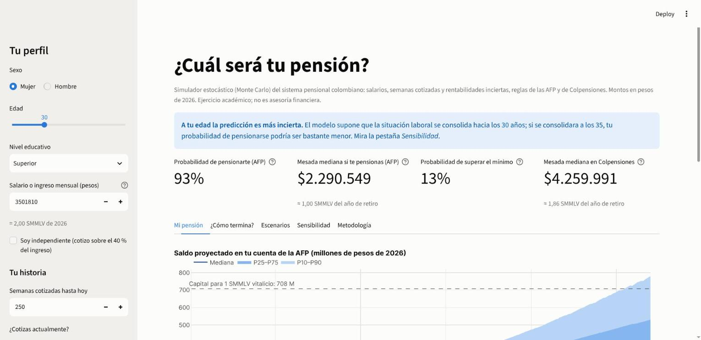
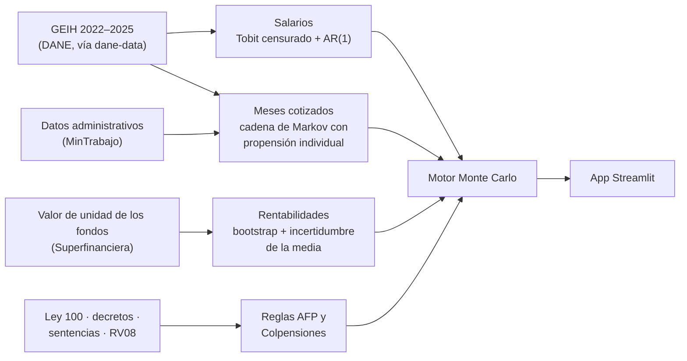

# Simulador estocástico de pensiones para Colombia

**¿Cuál es la distribución de la pensión futura de un afiliado al sistema pensional colombiano?**

Los simuladores de las AFP entregan un solo número. Este proyecto entrega una distribución. Simula miles de vidas laborales de una persona y en cada una combina tres fuentes de incertidumbre:
- su salario futuro;
- los meses que cotizará, estimados con microdatos de la GEIH;
- las rentabilidades de los fondos.

Al final aplica las reglas de la Ley 100 en una AFP y en Colpensiones.



## Hallazgos principales

Resultados del modelo con sus supuestos base. Las cifras de un perfil corresponden a una mujer de 30 años con educación superior que gana 2 SMMLV, cotiza hoy y tiene 250 semanas.

1. **Se pensiona quien acumula semanas, no quien tiene mejor rentabilidad.** Rentabilidad, tasa técnica y crecimiento salarial mueven la probabilidad de pensionarse menos de medio punto. Además, 4 de cada 10 cotizantes ganan el salario mínimo; para ellos, la pensión depende casi por completo de la garantía de pensión mínima.
2. **Casi todos cotizan casi siempre o casi nunca.** Con la composición educativa de los jóvenes, el 40 % alcanzaría las semanas de la garantía de pensión mínima. Va del 4 % (mujeres con primaria o menos) al 67 % (hombres con educación superior). Con la composición de quienes hoy tienen 60–70 años da 22 %, en línea con la cobertura pensional observada (18–30 %).
3. **En las AFP, la clase media termina en la pensión mínima.** Financiar 1 SMMLV de por vida cuesta 541 millones de pesos de 2026 a una mujer de 57 años y 408 millones a un hombre de 62. La mujer de referencia se pensiona en el 94 % de los casos, pero solo en el 12 % su saldo financia más que el mínimo. En Colpensiones recibiría ~1,85 SMMLV.
4. **Ahorrar un poco más puede no servir.** Con un aporte voluntario del 2 % del salario, la mesada no cambia en el 83 % de las simulaciones y solo vuelve la mitad del valor ahorrado; el resto reemplaza lo que habría pagado el Estado.
5. **La edad de retiro es la palanca más potente.** Pensionarse a los 62 en vez de a los 57 equivale aproximadamente a un aporte voluntario del 5 % durante 27 años: la probabilidad de financiar más que el mínimo pasa del 12 % al 27 %. Combinadas, al 44 %.
6. **El fondo importa, y "conservador" no significa seguro.** Todo en el fondo de mayor riesgo da un 19 % de probabilidad de financiar más que el mínimo, frente al 4 % del conservador. En el choque de inflación y tasas de 2021–2022, el fondo conservador de Protección cayó un 21 % real, más que el de mayor riesgo (19 %).
7. **Brecha de género.** Con la misma educación, salario e historia, el hombre financia más que el mínimo en el 48 % de los casos y la mujer en el 12 % (27 % si se retira a los 62). Las mujeres cotizan menos meses, se pensionan 5 años antes y viven más.
8. **Colpensiones paga más que la AFP en todos los niveles de ingreso, sobre todo a las mujeres.** A 8 SMMLV paga 1,7 veces más a la mujer y 1,2 veces más al hombre, porque su fórmula no depende de la esperanza de vida.

## Cómo funciona



| Componente | Modelo | Detalle |
|---|---|---|
| Salarios | Tobit heterocedástico censurado en el mínimo + auxilio de transporte (41 % de los cotizantes), con componente permanente y choque AR(1) por educación × sexo | [Metodología §2](docs/metodologia.md#2-salarios) |
| Cotización | Cadena de Markov mensual: propensión individual que se mueve hasta los 30 años y se consolida después, calibrada con 4 momentos (rotación de 6 meses, antigüedad en el empleo por edad, afiliados) | [§3](docs/metodologia.md#3-densidad-de-cotización) |
| Rentabilidades | Bootstrap estacionario de los cuatro fondos a la vez (Protección, 2016–2026), con incertidumbre sobre la media y la trayectoria de multifondos del Decreto 2555 de 2010 | [§1](docs/metodologia.md#1-rentabilidades) |
| Pensión | **AFP:** capital suficiente (Res. MinHacienda 3099 de 2015), garantía de pensión mínima o devolución de saldos. **Colpensiones:** tasa de reemplazo del art. 34 de la Ley 100 o indemnización. Tablas RV08 y 13 mesadas | [§4](docs/metodologia.md#4-acumulación-mesada-y-reglas-de-pensión) |
| Motor | 10.000 vidas en ~2 s, condicionadas en el salario, las semanas y el saldo actuales; números aleatorios comunes entre escenarios | [§5](docs/metodologia.md#5-motor-de-simulación) |

Las reglas legales, con su fuente y estado de verificación, están en el [marco normativo](docs/marco_normativo.md) y en [`config/parametros.yaml`](config/parametros.yaml).

## Validación

| Qué se comparó | Resultado |
|---|---|
| Liquidación real de Colpensiones confirmada por un tribunal (2018) | Tasa de 63,58 % y mesada de $1.909.262, idénticas (prueba automática) |
| Salarios de 2025 con el modelo estimado solo hasta 2024 | Error de 1,7 % en la mediana, igual que dentro de muestra |
| Tasas de cotización de 2025 con las de 2023–2024 | Error de 1–4 puntos por edad |
| Capital para una pensión mínima frente a la referencia de mercado (330 SMMLV) | 309 SMMLV; ~330 con cónyuge |
| Cobertura pensional | 22 % frente a 18–30 % |
| Rentabilidades a 36 meses, fuera de muestra | El intervalo P10–P90 contuvo lo realizado en el 63 % de las ventanas (debería ser 80 %): el modelo subestima crisis como la de 2021–2022 |
| Error de Monte Carlo | Igual al binomial teórico (~0,5 puntos con 10.000 simulaciones) |

**La validación cambió el modelo cuatro veces:**
1. Con rotación constante, los periodos de cotización de los mayores eran más cortos que su antigüedad en el empleo.
2. Con una propensión a cotizar permanente, las semanas de un joven decidían su destino: con 0 o 100 semanas a los 25 años, la probabilidad de pensionarse era 1 % o 93 %.
3. El capital suficiente debe verificarse con el crecimiento regulatorio de los beneficios (2,53 %), no con el supuesto económico del SMMLV.
4. Sin incertidumbre en la media, las rentabilidades eran demasiado confiadas.

Detalle en [`notebooks/07_validacion.ipynb`](notebooks/07_validacion.ipynb) y [Metodología §6](docs/metodologia.md#6-validación).

## Uso

### App

```bash
pip install -e ".[app]"
streamlit run app/streamlit_app.py
```

Para publicarla en Streamlit Community Cloud basta apuntar a `app/streamlit_app.py`: `requirements.txt` instala el paquete con el extra `app`.

### Librería

```python
from pension_mc.simulate import Perfil, Supuestos, simular

r = simular(Perfil(edad=30, sexo="Mujer", educacion="Superior", salario=3_500_000,
                   semanas=250, cotiza_hoy=True))
r.resumen()          # probabilidades, mesadas, semanas, saldo, costo de la garantía, Colpensiones
r.afp, r.colpensiones  # una fila por simulación

simular(Perfil(edad=30, sexo="Mujer", educacion="Superior", salario=3_500_000, semanas=250,
               cotiza_hoy=True, edad_retiro=62), Supuestos(tasa_tecnica=0.03))
```

### Pruebas y reestimación

```bash
pip install -e ".[dev]"      # motor + pruebas, con los modelos versionados en artefactos/
pytest                       # 89 pruebas; CI en Python 3.11, 3.12 y 3.13

# Re-estimar todo desde los datos (GEIH vía dane-data; requiere pdftotext)
pip install -e ".[datos,notebooks]"
python -m pension_mc.data
```

## Estructura

```
├── app/streamlit_app.py      # app
├── artefactos/               # modelos estimados y series que usa el motor (versionados)
├── config/parametros.yaml    # parámetros legales y supuestos, con fuente y estado de verificación
├── docs/                     # marco normativo, datos y metodología
├── notebooks/                # 01 EDA · 02 rentabilidades · 03 salarios · 04 cotización ·
│                             # 05 reglas de pensión · 06 motor · 07 validación
├── src/pension_mc/
│   ├── data/                 # descarga y procesamiento (IPC, valor de unidad, RV08, GEIH)
│   ├── returns.py            # rentabilidades y multifondos
│   ├── wages.py              # salarios
│   ├── contributions.py      # densidad de cotización
│   ├── accumulation.py       # saldo
│   ├── decumulation.py       # de saldo a mesada
│   ├── regimes.py            # reglas de AFP y Colpensiones
│   └── simulate.py           # motor, escenarios y sensibilidad
└── tests/                    # 89 pruebas, incluida la app
```

## Fuentes

- **DANE:** GEIH 2022–2025 (procesada con [dane-data](https://github.com/IntegralIndefinida/DANE-data)) e IPC.
- **Superintendencia Financiera:** valor de unidad de los fondos de pensiones obligatorias (datos.gov.co `uawh-cjvi`) y tablas de mortalidad RV08 (Resolución 1555 de 2010).
- **MinTrabajo:** afiliados al Sistema General de Pensiones (datos.gov.co `sk9s-yxmi`).
- **Normativa:** Ley 100 de 1993 (texto compilado), Decreto 2555 de 2010, Resoluciones MinHacienda 3099 de 2015 y 1045 de 2026, sentencias C-197 de 2023, C-054 de 2024 y C-264 de 2026.

## Limitaciones

- Supone las reglas actuales. La reforma pensional (Ley 2381 de 2024, vigente desde abril de 2027) aún no está modelada.
- No incluye bono pensional, traslados entre regímenes, invalidez ni sobrevivientes (el cónyuge beneficiario es opcional).
- La propensión a cotizar no depende del salario.
- Las tasas de cotización son de corte transversal: no hay tendencia de formalización.
- Diez años de rentabilidades subestiman la frecuencia de crisis como la de 2021–2022.
- La comparación AFP vs. Colpensiones aplica ambas reglas a la misma persona, aunque en la realidad cada afiliado está en un solo régimen.
- Pendientes de verificar en la fuente oficial: la tasa técnica (4 %), el calendario de semanas de las mujeres en las AFP y el porcentaje de la indemnización sustitutiva (ver el [marco normativo](docs/marco_normativo.md)).

---

*Ejercicio académico de Luis Ramírez ([@IntegralIndefinida](https://github.com/IntegralIndefinida)). No constituye asesoría financiera ni pensional; para decisiones reales, use la doble asesoría de su AFP y de Colpensiones.*
